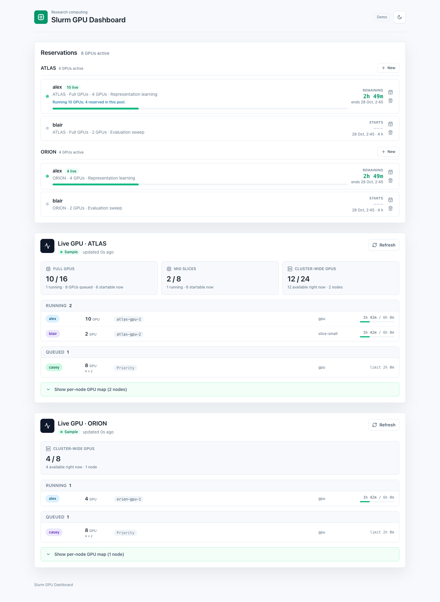

# Slurm GPU Dashboard

A lightweight GPU monitoring and reservation dashboard for research groups on Slurm.
See allocated GPUs, understand queue pressure, and coordinate planned usage across clusters and GPU pools.

[Live demo](https://peter-lizijia.github.io/slurm-gpu-dashboard/) · [Deployment guide](docs/deployment.md) · [Collector guide](docs/slurm-agent.md)



[Dark theme preview](docs/images/dashboard-dark.png)

## What it does

- Live account usage, running and pending jobs, GPU nodes, and stored allocation history.
- Separate budgets for GPU pools, including full GPUs and MIG slices.
- Reservations with overlap checks, available capacity, and per-user live allocation comparisons.
- Light and dark themes, mobile layouts, and local-time scheduling.
- Optional Google sign-in and Supabase persistence with public reads and owner-only reservation writes.
- A Python collector that runs as a small CPU-only Slurm job under an ordinary user account.

This is a coordination tool, **not a scheduler**. Reservations do not submit jobs, reserve Slurm resources, or enforce fair-share policy. GPU usage means **Slurm allocation**, not device utilization from `nvidia-smi`.

## Try it locally

Requires Node.js 22.12+ (Node 24 LTS recommended).

```bash
git clone https://github.com/peter-lizijia/slurm-gpu-dashboard.git
cd slurm-gpu-dashboard
npm install
npm run dev
```

Open the URL printed by Vite. No database, credentials, or cluster connection is needed.

The default demo uses fictional **ATLAS** and **ORION** clusters. Try creating, editing, and deleting reservations. Changes live only in that browser tab's memory and reset on reload. Sample telemetry is illustrative, not a recording of a real cluster. The demo never connects to Supabase.

## Use it for your group

1. Edit [`config/clusters.json`](config/clusters.json): cluster IDs, Slurm account, member usernames, partitions, and each pool's actual GPU capacity.
2. Create your own Supabase project and apply the initial schema. Enable Google OAuth and approve specific email addresses. See [deployment](docs/deployment.md).
3. Clone your customized repo on each cluster, configure a server-side key, and start the CPU-only collector. See [Slurm setup](docs/slurm-agent.md).
4. Deploy the static frontend with your project's **publishable** key. Never use a server secret in a browser build.

A normal Slurm account is enough only when your site permits the required queries, batch submissions, and outbound HTTPS from the collector node. Ask your administrator about local monitoring policies first.

## Architecture

```text
sinfo / squeue / scontrol / sacctmgr
                |
       Python collector on Slurm
                | HTTPS, server-only key
                v
         Supabase Postgres + Auth
                | public reads / authenticated owner writes
                v
       React + TypeScript + Vite
          static hosting / Pages
```

Default cadence: collector every 60 seconds, browser every 120 seconds, history every 5 minutes with 48-hour retention. The browser displays freshness; this is polling, not a continuous GPU sensor feed.

```text
config/                   Shared cluster and pool configuration
src/components/           Dashboard, live telemetry, reservations
src/data/demo.ts          Synthetic data and in-memory demo adapter
src/services/             Supabase and data-source boundary
src/hooks/                Session and polling lifecycle
src/utils/                Capacity checks, time and formatting
scripts/                  Python Slurm collector and job management
supabase/migrations/      Initial schema, explicit grants and RLS
tests/                    Collector and database permission tests
docs/                     Deployment, operations and privacy
```

For another backend, replace the functions in `src/services/liveCluster.ts` and `src/services/usageReports.ts`, implement an authentication adapter, and replace `SupabaseWriter` in the collector. The UI's TypeScript types describe the data contract; no particular institution is required.

## Development

Python 3.10+ is needed for collector tests; no Python packages are required.

```bash
npm ci
npm test
npm run build
npm run check:public
```

Database tests run locally with PGlite against both restrictive and legacy default grants. They do not use a hosted Supabase project. CI runs the same checks. The separate Pages workflow publishes the fictional demo by default.

Browser checks cover desktop/mobile, themes, local-only demo requests, reservation CRUD and capacity conflicts:

```bash
npx playwright install chromium
npm run test:ui
```

## Privacy and limitations

This repository contains neutral branding, synthetic fixtures, example configuration, and a fresh history. It contains no deployment credentials or real cluster snapshots.

**A production deployment is publicly readable by default.** Telemetry includes Slurm usernames, nodes, job IDs and scheduling details; reservations include display names and reasons. Job names and cross-account usage totals are opt-in, but scheduler reservation metadata can still reveal account or reservation names. Review [security and privacy](SECURITY.md) before connecting a real cluster.

Capacity checks are advisory and client-side; concurrent submissions can race. Slurm usernames are self-declared, not cryptographically linked to OAuth identities. Site-specific Slurm visibility, QOS rules, CPU/memory requirements, maintenance, and priority can prevent a job from starting even when the dashboard estimates capacity is available. Storage monitoring is intentionally outside this public GPU-focused edition.

## License

[MIT](LICENSE). Contributions and adaptations for other research groups are welcome.
